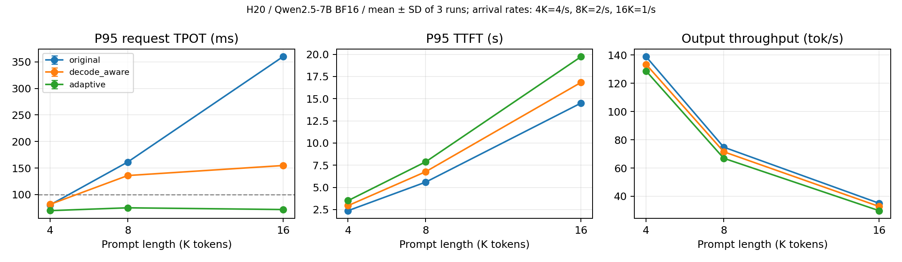

# NanoSched Performance Report — H20 / 2026-10-23

## 结论

本版本交付可切换的 Prefill-First、固定 Decode-Aware、Adaptive Prefill Budget，以及持续到达回放和原始计时数据。Adaptive 在长 Prompt 竞争中减少 Decode 停顿，但通常增加 TTFT 并降低吞吐；没有证明它普遍优于针对负载调好的固定 Chunk。

8K 竞争负载中，三次均值 P95 TPOT 从原版约 161 ms 降至 75 ms，低于配置的 100 ms 目标；吞吐由约 74.79 降至 66.91 tok/s，TTFT P95 由约 5.59 增至 7.88 s。16K 竞争中的 TPOT 改善更大，但同样有成本，见完整数表。100 ms 是反馈目标，不是硬实时保证；16K 实测最大 ITL 仍超过 100 ms。

## 初始成果检查与归属

任务开始时工作区干净，分支 `dev/scheduler-kv`，HEAD `b4df56d`，相对远端领先 11 个本地提交，main/上游基线为 `bb823b3`。已存在的 Qwen2.5 显式适配、Greedy Sampling、固定 Decode-Aware、持续回放、逐 Token 记录均有代码与已有测试/测量，本轮直接扩展它们，保留历史成果。

- 上游已有 Paged KV、Prefix Cache、基础 Chunked Prefill、抢占重算、FlashAttention、CUDA Graph、Tensor Parallelism。
- 本轮核心新增在 [Scheduler](../../nanovllm/engine/scheduler.py)：Decode 间隔 EWMA、Prefill 时间估计、活跃 Decode 成本估计、离散 Budget 选择与等待保护。核心实现提交 `4527778`，正式矩阵前的后续提交只增加/修正验证。
- [上游 PR #276](https://github.com/GeeeekExplorer/nano-vllm/pull/276) 已涉及混合 Prefill/Decode、Decode 优先及 KV 水位。这里的独立贡献是分阶段执行下的 SLO 反馈调度和 H20 消融，不宣称发明这些上游功能。
- 原版也能在当前 Qwen2.5 checkpoint 上正常生成，本地适配贡献是显式架构分派与验证，不宣称首次支持该模型。

## 配置与测量

单张 NVIDIA H20（GPU 0）、Qwen2.5-7B-Instruct、BF16、TP=1、CUDA Graph On。统一最大 Token Budget 2048、模型批次上限 32、上下文上限 32768。固定 Decode-Aware 在有 Decode 时使用 1024 Budget，无 Decode 时 2048；Adaptive 候选为 256/512/1024/2048，目标 TPOT 100 ms，队首 Prefill 服务等待目标 0.5 s。普通场景 memory utilization=0.45，压力组=0.22。

正式矩阵运行于干净的 `d933b6c` 或 `1754566`；两者差异仅为验证代码，调度和回放实现相同。正式矩阵有 11 个场景 × 3 个策略，每配置一次完整预热和三次计时，共 99 次计时回放。随机种子 20261023。场景和命令见 [commands.json](matrix/commands.json)，统计见 [CSV](matrix/results.csv)、[JSON](matrix/results.json)、[完整 Markdown 表](matrix/table.md)。原始请求、入队、逐 Token 和 Step 事件保存在各配置目录。

`original` 是共同模型/采样实现中的原版 Prefill-First 调度顺序，避免把模型路径变化混入策略收益；它包含已有公共状态处理，并非逐字节上游引擎。逐字节原版的生成验证单列。

独立线程记录计划到达、实际到达，主线程记录引擎入队。并发上限外的请求继续到达并排队。TTFT/E2E 从计划到达计时；负载发生器迟到和外部准入等待单独记录。TPOT 是每请求平均 Token 间隔后取请求间 P95；最大 ITL 是实际最大相邻 Token 间隔，二者不可混用。表中为三次指标的均值 ± 样本标准差。

竞争场景先有一个 128 输入/256 输出请求，随后持续到达长 Prompt/64 输出请求。4K、8K、16K 分别为 4、2、1 req/s，保持约 16K 输入 Token/s 的到达需求；并发上限 16。低速 4K 为 0.5 req/s、并发 4。所有对照保留同一请求集与共同配置；不是只选择一次性批次或只报告饱和场景。

## 主结果与退化

|场景|策略|TTFT P95 ms|TPOT P95 ms|E2E P95 ms|最大 ITL ms|输出 tok/s|
|---|---|---|---|---|---|---|
|short-1k|original|115.83 ± 0.32|8.22 ± 0.02|632.86 ± 0.17|117.05 ± 0.16|127.61 ± 0.05|
|short-1k|decode_aware|115.84 ± 0.19|8.22 ± 0.01|633.03 ± 0.24|117.09 ± 0.08|127.61 ± 0.05|
|short-1k|adaptive|124.02 ± 0.97|8.29 ± 0.01|644.66 ± 0.17|63.49 ± 0.18|127.40 ± 0.01|
|competition-4k-low|original|456.59 ± 0.68|6.40 ± 0.00|1266.89 ± 0.89|6.61 ± 0.04|47.38 ± 0.00|
|competition-4k-low|decode_aware|456.47 ± 0.11|6.40 ± 0.00|1266.52 ± 1.49|6.70 ± 0.02|47.38 ± 0.00|
|competition-4k-low|adaptive|456.55 ± 0.62|6.42 ± 0.01|1271.36 ± 1.75|6.70 ± 0.10|47.37 ± 0.00|
|competition-4k|original|2372.55 ± 0.92|80.55 ± 0.01|6289.29 ± 1.06|4993.02 ± 0.30|138.91 ± 0.02|
|competition-4k|decode_aware|2941.58 ± 6.16|81.58 ± 0.12|6469.89 ± 7.82|137.83 ± 0.21|133.45 ± 0.18|
|competition-4k|adaptive|3502.38 ± 6.67|69.77 ± 0.07|6403.41 ± 6.79|76.93 ± 0.05|128.77 ± 0.12|
|competition-8k|original|5590.86 ± 1.55|161.34 ± 0.02|12215.95 ± 1.18|10866.25 ± 1.32|74.79 ± 0.01|
|competition-8k|decode_aware|6768.00 ± 1.40|135.87 ± 0.03|11985.77 ± 1.45|160.30 ± 0.07|71.53 ± 0.01|
|competition-8k|adaptive|7882.01 ± 1.44|75.10 ± 0.01|11548.24 ± 1.42|93.62 ± 0.26|66.91 ± 0.01|
|competition-16k|original|14505.21 ± 2.75|359.87 ± 0.03|26764.83 ± 2.38|25218.87 ± 2.33|35.06 ± 0.00|
|competition-16k|decode_aware|16833.81 ± 2.73|154.76 ± 0.02|21046.83 ± 2.86|211.95 ± 0.06|32.78 ± 0.00|
|competition-16k|adaptive|19733.84 ± 6.13|71.85 ± 0.01|21727.49 ± 6.13|109.85 ± 0.09|29.80 ± 0.01|
|mixed-16k|original|4096.14 ± 0.55|56.22 ± 0.00|5685.78 ± 0.39|2941.76 ± 0.57|83.73 ± 0.00|
|mixed-16k|decode_aware|4273.01 ± 0.60|58.85 ± 0.01|6584.30 ± 0.54|195.26 ± 0.04|81.41 ± 0.00|
|mixed-16k|adaptive|4768.16 ± 1.78|60.69 ± 0.01|7070.36 ± 2.03|96.41 ± 0.06|77.11 ± 0.02|
|pressure-16k|original|29312.73 ± 2.28|193.09 ± 0.02|32504.93 ± 2.54|11580.38 ± 1.66|26.34 ± 0.00|
|pressure-16k|decode_aware|31168.66 ± 3.27|154.80 ± 0.03|34320.72 ± 3.40|201.87 ± 0.25|25.10 ± 0.00|
|pressure-16k|adaptive|35207.32 ± 12.01|71.54 ± 0.02|37473.13 ± 12.45|111.28 ± 0.22|22.80 ± 0.01|

图中到达率随输入长度调整，不能将曲线变化单独归因于长度。完整矩阵还包括 1K/4K/8K 混合与并发 4 的消融。

原版的 ITL P95 有时更低：多数 Token 在集中 Decode 阶段快速产生，少量秒级停顿被 P95 排除。自适应将长停顿分摊成较短但更频繁的间隔，因此必须同时检查最大 ITL、每请求 TPOT 与 TTFT，不能只选择有利的分位数。

1. **Prefill-First 何时恶化？** 在新 Prefill 持续到达、队列不能及时排空时，已开始输出的 Decode 被推迟。8K/16K 竞争的原版最大 ITL 达到秒级。低速 4K 三策略几乎相同，短请求场景也没有吞吐收益。
2. **固定 Decode-Aware 改善什么？** 显著缩短连续 Decode 停顿，但 TTFT 通常增加，吞吐可能下降。4K 竞争下 P95 TPOT 并未优于原版，尽管最大 ITL 大幅下降，说明指标选择会改变结论。
3. **Adaptive 是否更好？** 相对统一固定 1024，它在 8K/16K 竞争中改善 TPOT 和 ITL；代价是更多小 Prefill 批次。4K 校准中基本等同固定 512，不能宣称优于调好的固定策略。16K 混合场景平均 TPOT、TTFT、吞吐均可能退化，只是最坏停顿更短。
4. **收益在哪些条件明显？** 长 Prompt、较高到达率、有活跃 Decode 的竞争场景更明显。低速负载基本无收益；降低并发到 4 会降低批处理效率并增加外部排队。没有给出跨模型/跨 GPU 的泛化结论。
5. **CPU 开销？** 见下表。Schedule 计时排除 Trace 构造；总占比包含 postprocess 中的反馈、Block Hash 与状态更新。它是整体调度/状态管理耗时，不能把差值全部当成反馈控制器独占 CPU 时间。

|策略|场景平均 Schedule μs 范围|最高场景 P95 μs|最高场景 CPU 时间占比 %|
|---|---|---|---|
|original|11.19–30.25|76.30|0.226|
|decode_aware|10.49–17.88|47.16|0.213|
|adaptive|13.36–18.58|27.25|0.320|

## 固定 Chunk 消融与 SLO 配置

首轮 4K / 4 req/s / 并发 16 校准使用种子 20261022，每配置三次。核心控制器与正式矩阵相同；早期校准的提交/dirty 状态保留在 environment.json。下表只在这组相同请求之间比较，不将不同种子的结果直接计算成策略收益。

|固定/自适应|TTFT P95 ms|TPOT P95 ms|最大 ITL ms|输出 tok/s|
|---|---|---|---|---|
|fixed-256|4605.02 ± 15.70|41.96 ± 0.11|49.97 ± 0.17|117.57 ± 0.26|
|fixed-512|3490.69 ± 0.71|69.76 ± 0.00|76.93 ± 0.04|128.87 ± 0.03|
|fixed-1024|2939.44 ± 1.35|81.52 ± 0.02|137.82 ± 0.06|133.55 ± 0.00|
|fixed-2048|2592.77 ± 4.85|80.20 ± 0.05|249.82 ± 0.05|137.44 ± 0.06|
|adaptive|3465.88 ± 3.43|69.38 ± 0.03|76.49 ± 0.04|129.35 ± 0.08|

256、512、1024、2048 均实际在 H20 运行。更小 Chunk 缩短停顿但增加迭代次数。自适应在该场景主要落在 512，因此额外收益接近零；这些候选是本次已验证的配置，不宣称是全局最优。

另以正式 4K 竞争请求集，保持其他配置不变，测量 50/100/200 ms 目标。每组仍为三次；[原始汇总](slo-results.json) 包含实际 Chunk 分布。

|TPOT 目标 ms|TTFT P95 ms|TPOT P95 ms|最大 ITL ms|输出 tok/s|
|---|---|---|---|---|
|50.0|4613.74 ± 14.91|42.01 ± 0.07|50.09 ± 0.14|117.40 ± 0.25|
|100.0|3502.38 ± 6.67|69.77 ± 0.07|76.93 ± 0.05|128.77 ± 0.12|
|200.0|2944.34 ± 9.66|81.55 ± 0.09|138.20 ± 0.61|133.46 ± 0.13|

目标可改变 Chunk 选择及延迟/吞吐取舍。最小 Chunk、历史耗时估计误差、GPU 批次不可中断，都可能使实际 ITL 超过目标。每请求平均 TPOT 达标也不意味着所有 Token 间隔达标。TTFT 5 s 只用于 Benchmark 的组合 Goodput 计算，控制器没有承诺满足该 TTFT SLO。

## KV 压力

16 个 16K 输入/64 输出请求，2 req/s，并发上限 16，将 KV Pool 对应显存比例降至 0.22。三策略使用相同配置。

|策略|KV 峰值 %|抢占次数|重算 Token|外部准入等待 P95 ms|
|---|---|---|---|---|
|original|90.49 ± 0.00|0.00 ± 0.00|0.00 ± 0.00|346.32 ± 1.23|
|decode_aware|75.17 ± 0.00|0.00 ± 0.00|0.00 ± 0.00|266.76 ± 0.73|
|adaptive|45.01 ± 0.00|0.00 ± 0.00|0.00 ± 0.00|267.03 ± 0.17|

KV 占用变化来自调度改变了同时存活请求数，BlockManager 算法没有变化。本组没有发生 GPU 抢占或重算，因此不能声称抢占优化收益；CPU 状态测试另行验证三策略的抢占恢复。外部准入等待包含等待同步 GPU Step 返回的时间，此外还可能存在引擎内部的 KV 分配等待。

## 生成正确性与实际验收

|验收项|实际证据|
|---|---|
|A 原版正常生成|未修改的 `bb823b3` checkout 使用同一 Qwen2.5 模型生成 `42`，见 [输出](upstream-generation.json)。原版使用 temperature=0.1，本地 Greedy 使用 0，不把两者当性能对照。|
|B 优化版生成与验证|[优化入口输出](optimized-generation.json) 同样生成 `42`；[GPU 生成检查](generation-validation-concurrent.json) 覆盖串行与并发、1K/4K/8K/16K、三策略和多种 Chunk，40/40 组语义答案和完整 Token（包括 EOS）对照通过；[CPU 测试](unit-tests.txt) 30 项通过，覆盖状态、引用计数、Chunk 边界与抢占恢复。|
|C 同组请求切换策略|三个策略的 workload.json 内容和公共配置在汇总时直接比较一致，命令和请求均保存。|
|D H20 真实对照|11 场景、三策略、每配置三次，全部原始 JSON/CSV 与均值/标准差已保存。|
|E 独立调度代码|`git diff main -- nanovllm/engine/scheduler.py nanovllm/config.py` 可查看实现，核心增量提交 `4527778`。|

首次串行语义检查误把输出的 EOS 文本标记计入答案，断言失败；修复解码方式后重跑，预期答案未修改，完整 Token 比较仍包含 EOS。[初次输出](generation-validation-with-eos.json) 保留。

自然语言检查通过不等于所有动态 Batch 的 Token 都一致。随机 Token 性能负载的逐请求完整输出对照如下（每格列出三次重复）：

|场景|策略|每次完整匹配请求数|每次请求数|
|---|---|---|---|
|short-1k|decode_aware|[11, 11, 11]|12|
|short-1k|adaptive|[10, 9, 10]|12|
|mixed-1k|decode_aware|[11, 12, 12]|12|
|mixed-1k|adaptive|[9, 10, 9]|12|
|mixed-4k|decode_aware|[12, 12, 12]|12|
|mixed-4k|adaptive|[11, 11, 11]|12|
|mixed-8k|decode_aware|[12, 12, 12]|12|
|mixed-8k|adaptive|[11, 11, 11]|12|
|mixed-16k|decode_aware|[12, 12, 12]|12|
|mixed-16k|adaptive|[11, 11, 11]|12|
|competition-4k-low|decode_aware|[8, 8, 8]|8|
|competition-4k-low|adaptive|[8, 8, 8]|8|
|competition-4k|decode_aware|[10, 10, 10]|12|
|competition-4k|adaptive|[10, 10, 10]|12|
|competition-4k-c4|decode_aware|[10, 10, 10]|12|
|competition-4k-c4|adaptive|[11, 11, 11]|12|
|competition-8k|decode_aware|[11, 11, 11]|12|
|competition-8k|adaptive|[11, 11, 11]|12|
|competition-16k|decode_aware|[12, 12, 12]|12|
|competition-16k|adaptive|[12, 12, 12]|12|
|pressure-16k|decode_aware|[13, 13, 13]|16|
|pressure-16k|adaptive|[14, 14, 14]|16|

不同 Batch/Chunk 下存在 BF16 输出分歧，不能声明全量逐 Token 一致。此前固定 Token 历史、只改变 Batch 形状的[最小复现](../decode_aware/batch_shape_repro.py)已证明一个并列 logits 分歧；本轮没有逐个归因所有差异。自然语言答案、状态不变量和 Token 计数检查是本次验证范围，不是完整模型质量评估。

## 复现与边界

运行命令见 [README](../../README.md) 和每组 environment.json/commands.json。完整矩阵入口为 `bash scripts/run.sh -m benchmarks.suite --model MODEL_PATH --output NEW_DIRECTORY`；单独回放可配置 policy、输入/输出长度、到达率、并发、目标 TPOT 和 seed。

- 本轮为有限持续到达负载，不是长期稳态生产服务，P95 基于每次 8–16 个请求；三次重复不足以主张广泛统计显著性。
- 性能 Prompt 是合成 Token，忽略 EOS 固定输出长度；自然语言正确性单独验证。
- 只有 H20、Qwen2.5-7B-Instruct、BF16、TP=1 的实测结论。未测试 32K 输入、多卡或新模型。
- KV 仍按完整 Prompt 预留，无增量预留、KV 水位准入或混合 Attention。
- 引擎为进程内 Python 接口，不包含网络服务；固定 NCCL 端口要求当前入口串行运行。
- 项目保留无收益、退化及数值差异，不宣称 Adaptive 普遍更快或保证 SLO。
