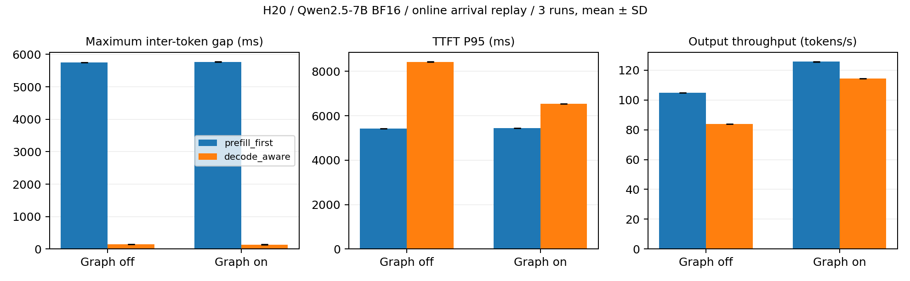

# NanoSched H20 Phase 0 / Phase 1 实测报告

日期：2026-10-22（Asia/Shanghai）。范围：Qwen2.5-7B-Instruct，单张 H20，BF16，TP=1。

Decode 优先确实缩短了长 Prompt 竞争下的 Decode 停顿，同时增加 TTFT、增加 Decode 迭代次数，并使部分负载吞吐下降。**本轮没有得到“全面更快”的结论。** 严格模型数值门槛仍有失败项，因此 Phase 0 的数值验收尚未完全通过，性能结论只描述已记录的实现和负载。

## Phase 0 交付

- **已完成：** 原始与适配基线 worktree；架构/分片检查；Qwen2 的 bias / QK Norm 适配；339/339 严格权重加载；Greedy 与混合采样；真实 H20 单请求、Batch、Prefix、Chunk 生成；Transformers BF16 对照与 FP32 小模型端到端数学对照；初始化时间和显存记录。
- **改动文件：** [config](../../nanovllm/config.py)、[Qwen2](../../nanovllm/models/qwen2.py)、[共享 Qwen 模块](../../nanovllm/models/qwen3.py)、[loader](../../nanovllm/utils/loader.py)、[sampling](../../nanovllm/layers/sampler.py)、[模型回归](../../tests/test_model_correctness.py)、[正确性工具](../../benchmarks/correctness.py)。
- **测试情况：** 最新 CPU 回归 **24 passed**，见 [日志](unit_tests_fp32_fix.txt)。FP32 小型 Qwen2 的实际 Transformers 权重经 loader 加载后，最终 logits 在 rtol=1e-5 / atol=1e-6 下匹配。该测试用 CPU Dense Attention 替代 FlashAttention，明确不代表 GPU FP32 推理验证。
- **GPU 测试：** 339/339 权重加载；Greedy 数学提示生成 `42` 并正常 EOS；4 个提示包含中文和 1239 Token 长提示；Serial 与 Batch 对参考各 3/4 精确匹配，重复生成 4/4 可复现，Graph On/Off 均实际运行。
- **性能变化：** 原版与适配基线的同 temperature=1 对照见下表；不将 Greedy 与随机采样的差异归因于调度。
- **问题与限制：** 中文提示有 Greedy 分歧；8ef7814 相同历史的最大相对 L2 logits 误差约 3.68%，145e55b 复测约 2.98%，均超过预设 2% 门槛，程序返回 1，未放宽门槛。近似并列 Token 和不同 BF16 Kernel 可能参与该分歧，原因尚未完整归因。
- **下一步：** 优先进行逐层 BF16 / Attention 数值定位，建立完整模型精度验收；不能用 CPU 回归替代该工作。

## Phase 1 交付

- **已完成：** 可配置 Prefill-First / Decode-Aware；Decode 优先与轮转；连续服务次数限制；Prefill 软等待保护；防止过期 Prefill 队列反向饿死 Decode；两档 Token Budget；阶段/队列/缓存/抢占/重算统计。保留不同迭代执行 Prefill 和 Decode。
- **改动文件：** [Scheduler](../../nanovllm/engine/scheduler.py)、[Sequence](../../nanovllm/engine/sequence.py)、[配置](../../nanovllm/config.py)、[回放工具](../../benchmarks/replay.py)、[聚合工具](../../benchmarks/analyze.py)、[调度回归](../../tests/test_scheduler.py)。
- **测试情况：** 单元测试先稳定复现 Prefill-First 饥饿，再验证连续 Decode 上限、等待保护、过期队列、Chunk 不提前输出 Token、Block RefCount、Prefix 生命周期和抢占恢复；相关检查均在 24 项通过的回归中。
- **GPU 测试：** 三种负载 × 两种调度 × Graph On/Off，共 12 配置，每配置完整回放预热后测量 3 次，原始时间戳和 Token ID 全部保存。另对最终过期队列修复的 Eager 竞争配置重新测量 3 次并用于正式聚合。
- **性能变化：** Graph On 的竞争负载，最长 Token 间隔降低 97.6%，请求 TPOT P95 降低 87.8%；TTFT P95 增加 20.1%，输出吞吐下降 9.0%。已有请求自身的平均 TPOT 只从约 52 ms 降到 41 ms，不能把总体请求 P95 的降幅当作每个请求的改善幅度。
- **问题与限制：** Prefill 排队延迟、长请求 TTFT 与吞吐有退化；100 ms 是批次边界的软保护，不是墙钟 SLO。严格 SLO 下竞争负载 Goodput 两种策略均为 0。
- **下一步：** 在模型数值验收之后，再研究 Chunk/Budget 与 Decode 限额的消融；Adaptive Chunk 和 Incremental KV Reservation 留待 Phase 2/3。

## 环境与版本

服务器 AIC-C01-H20-n05，物理 GPU 0，NVIDIA H20，97871 MiB，SM90；运行前八张卡均无计算进程，本轮只使用 GPU 0。驱动 535.161.08，复用 CUDA 12.9 compatibility 库；实际 CUDA 分配、推理及 FlashAttention 均执行成功。

|项目|记录|
|---|---|
|Python|3.10.12，既有 nonprefix-kv-20261008 环境|
|PyTorch / CUDA|2.13.0+cu129 / 12.9|
|Triton / Transformers|3.7.1 / 5.17.0|
|FlashAttention|2.7.4.post1，复用现有编译扩展，未重编译|
|xxhash / pytest|4.0.2 仓库专用目录 / 9.1.1 既有环境|
|模型|Qwen2.5-7B-Instruct，标准 Qwen2ForCausalLM，max_position_embeddings=32768|
|实测参数|BF16，TP=1，max_model_len=8192，Batch 上限 32，Token Budget 1024，Memory Utilization 0.45|
|策略参数|max_consecutive_decodes=4，prefill_max_wait_ms=100，decode_prefill_token_budget=1024|
|随机种子|20261022；每个计时重复重置 RNG 与 Prefix Cache 元数据|
|逐字节上游|bb823b3，NanoSched-baseline-bb823b3 worktree|
|适配基线|2e1e4e6，NanoSched-baseline-phase0 worktree|
|正式调度性能版本|8ef7814，NanoSched-phase1-8ef7814 worktree|
|后续 FP32 别名修复|145e55b，NanoSched-phase1-final worktree，单独验证，不篡改已有性能版本|

4 个分片的索引覆盖、所有 tensor offset 边界通过检查。[模型预检](model_preflight.json)、[权重 SHA256](model_shards.sha256)、[FA 扩展 SHA256](flash_attention_binary.sha256)、[GPU 清单](gpu_inventory.csv) 都已保留。SHA256 是本地文件身份记录，没有声称对比过未提供的官方校验和。

初始化测量包含模型加载、引擎内部预热、KV 分配及可选 Graph capture：适配基线 Eager 5.998 s / Graph 7.770 s；调度版 Eager 3.952 s / Graph 5.519 s。不是受控冷启动测试，不能据此声称初始化加速。Eager 初始化后 PyTorch allocated 约 42.15–42.22 GiB，Graph 约 42.25 GiB，均**包含 KV Pool**。Pool 受初始化峰值等影响实际为 2038–2043 Blocks，详见各配置 environment.json。没有 KV 压力时这点差异不构成 KV 容量优化的证据。

## 正式性能对照

完整方法见 [benchmark_methodology](../../docs/benchmark_methodology.md)。每个单元格为三次运行指标的均值 ± 样本标准差；[CSV](analysis/summary.csv) 另存 P50/P95/P99、E2E、样本方差、Scheduler 时间、KV 使用及 Commit。只做三次重复，不声称统计显著性。

short：8 × (128 输入 / 128 输出)；long：4 × (4096 / 128)；competition：1 个已有短 Prompt Decode + 12 个持续到达的 4096 Token 长 Prompt + 8 个持续到达短请求。所有输出长度固定、忽略 EOS；每对配置 workload SHA256 相同。回放提交时间是计划到达，实际 Engine 入队时间另外记录，**没有声称测量了 HTTP 网络客户端**。

|负载|Graph|策略|TTFT P95 ms|TPOT P95 ms|最长 Token 间隔 ms|Output tok/s|Request/s|Goodput req/s|
|---|---|---|---:|---:|---:|---:|---:|---:|
|competition|eager|prefill_first|5426.32 ± 0.40|335.66 ± 0.13|5749.44 ± 0.61|104.95 ± 0.03|2.65 ± 0.00|0.00 ± 0.00|
|competition|eager|decode_aware|8425.65 ± 9.69|52.01 ± 0.12|145.87 ± 0.66|83.97 ± 0.07|2.12 ± 0.00|0.00 ± 0.00|
|short|eager|prefill_first|105.53 ± 0.09|16.97 ± 0.06|19.09 ± 1.28|452.85 ± 1.44|3.54 ± 0.01|3.54 ± 0.01|
|short|eager|decode_aware|105.49 ± 0.09|17.71 ± 0.01|19.61 ± 1.23|434.85 ± 0.34|3.40 ± 0.00|3.40 ± 0.00|
|long|eager|prefill_first|1783.92 ± 1.88|27.76 ± 0.04|1395.15 ± 2.20|125.80 ± 0.15|0.98 ± 0.00|0.00 ± 0.00|
|long|eager|decode_aware|2404.00 ± 1.40|27.28 ± 0.02|140.08 ± 0.68|110.04 ± 0.13|0.86 ± 0.00|0.00 ± 0.00|
|competition|graph|prefill_first|5450.03 ± 1.37|331.83 ± 0.06|5772.86 ± 1.52|125.64 ± 0.03|3.17 ± 0.00|0.00 ± 0.00|
|competition|graph|decode_aware|6542.78 ± 3.54|40.62 ± 0.01|137.20 ± 2.44|114.37 ± 0.06|2.89 ± 0.00|0.00 ± 0.00|
|short|graph|prefill_first|106.34 ± 0.12|5.84 ± 0.04|6.64 ± 1.25|1207.32 ± 6.99|9.43 ± 0.05|9.43 ± 0.05|
|short|graph|decode_aware|106.38 ± 0.09|5.83 ± 0.00|5.98 ± 0.12|1208.81 ± 0.49|9.44 ± 0.00|9.44 ± 0.00|
|long|graph|prefill_first|1795.94 ± 0.56|17.47 ± 0.00|1393.13 ± 0.26|184.97 ± 0.03|1.45 ± 0.00|0.36 ± 0.00|
|long|graph|decode_aware|2032.71 ± 0.36|17.30 ± 0.01|130.20 ± 0.13|171.03 ± 0.08|1.34 ± 0.00|0.33 ± 0.00|




以上使用 2e1e4e6 原版 Scheduler 的适配基线，排除了采样方式、Chunk Budget 或权重路径不同的混淆。最早 suite 中 Eager 调度版是 4dad4c2，保留作探索数据；正式分析使用 `final_competition_decode_aware_eager` 的 8ef7814 重新运行结果。其余正式调度配置均为 8ef7814。运行期间的 README 修改没有改变核心源码；各 environment.json 如实记录 tracked diff 和 Harness Hash。

### 原生上游对照

原版禁止 temperature=0，另将三者统一为 temperature=1、Eager、同样种子/请求/预热/输出长度，重复三次：

|版本（Eager，temperature=1）|输出 tok/s|最长 Token 间隔 s|
|---|---:|---:|
|upstream|106.400 ± 0.319|5.740 ± 0.001|
|adapted|105.700 ± 0.230|5.774 ± 0.001|
|optimized|83.991 ± 0.074|0.147 ± 0.000|

原始数据为 [upstream](native_upstream_eager/summary.json)、[adapted](native_adapted_eager/summary.json)、[optimized](native_optimized_eager/summary.json)。该表同时存在模型/低精度实现变化，调度因果结论应使用上方适配基线对照。最早 `upstream_competition_eager` 第一重复有额外编译，原样保留，未纳入正式统计。

## 观测与原因分析

- 两种策略均实际计算 50304 Prefill Token、811 Decode Token，输出 832 Token；两者每个竞争回放都有 57 个 Prefill 批次。第一重复中 Graph 基线 127 次 Decode，调度版 231 次。更早服务正在运行的请求减少了长停顿，也让 Decode 分散为更多小批次，这是吞吐/TTFT 退化的可见机制，而非减少 Prompt 计算带来的收益。
- Graph 竞争运行的 Scheduler 累计 CPU 时间由约 2.57 ms 增到 5.48 ms，远小于秒级总耗时；仅根据总耗时不能归因于 Python Scheduler 慢。Prefill/Decode 阶段切换和更多 Decode 迭代需要结合 Trace 判断。
- 已有请求的停顿有明确逐 Token 证据：基线最长约 5.77 s，优化约 0.137 s；每请求平均 TPOT 与相邻 Token 间隔分位数分开保存，未以总生成时间推算 TTFT/TPOT。
- short Eager 吞吐约下降 4%，Graph 则基本相当；该小幅变化没有完整归因，单 GPU 顺序执行、未锁定频率且样本少，不能贸然归于某个调度操作。long 两种模式都存在吞吐和 TTFT 退化。
- 竞争负载主表抢占和重复 Prefill 均为 0，Prefix 命中为 0。KV 引用峰值下降与请求更早完成有关，BlockManager 仍保留完整 Prompt 预留逻辑；**不宣称实现了增量 KV 分配或完成了高压性能验证**。
- 模型正确性回放记录 2048 Prefix 命中 Token / 4096 候选 Token，最终 KV 引用归零；这是功能验证，不能移作主性能基准的缓存命中收益。
- 预设 SLO 为 TTFT <= 0.5 s 且平均 TPOT <= 0.02 s。竞争负载两种策略的 Goodput 均为 0；吞吐更高不自动意味着 SLO 达标。

## Profiler 与 GPU 状态

PyTorch Profiler 实际完成独立诊断回放，退出码 0；[算子表](profiler/profile-0.txt)、[Chrome Trace](profiler/profile-0.json)、[诊断负载](profile_workload.json) 和逐 Token Trace 均已保留。没有将该诊断运行混入三次计时均值。当前环境 `nsys` 不在 PATH，未运行 Nsight Systems。

该短/长竞争诊断里，算子归因 `aten::mm` Self CUDA 391.890 ms，Prefill `flash_attn::_flash_attn_varlen_forward` 46.903 ms，`aten::addmm` 30.548 ms；可以看到大 Prompt GEMM 与 Attention 的成本。表里同时有操作与 Kernel 层级，不能把父项与子项重复相加。CUDA Graph 的短请求 TPOT P95 从约 17 ms 降到约 5.8 ms，但该观察只适用于本次配置。

[主实验 GPU 监控](suite/gpu_telemetry.csv) 和 [补充实验监控](followup_gpu_telemetry.csv) 每 500 ms 采样。GPU 利用率、功耗与显存有实际 CSV，未从吞吐反推。没有占用其他卡或终止无关进程，运行结束释放自身引擎和监控进程。

## 正确性失败和审计记录

- [Eager 最终对照](final_correctness_eager.json)、[Graph 最终对照](final_correctness_graph.json) 及对应 exit_code 均保留；严格数值门槛返回 1，没有伪装成成功。
- [早期 Tokenizer API 失败](correctness_eager.stdout) 已修复为显式 encode Chat Template；[初次输出/EOS 对照](correctness_eager.json)、[Teacher-forced 对照](correctness_eager_teacher.json)、[不同数值路径](correctness_precision_eager.json)、[HF FlashAttention2 对照](correctness_fa2_eager.json) 都未删除。
- 补充 FP32 端到端测试曾失败，发现 RMSNorm in-place 在 FP32 下会修改 Residual；[失败日志](unit_tests_fp32_adapter.txt) 与 [修复后 24 项通过](unit_tests_fp32_fix.txt) 均保留。修复版本 145e55b 使用非原地归一化，避免通过宽松断言掩盖问题。
- CPU 数学匹配、BF16 重复性、跨 Batch 精确一致和完整模型 logits 容差是不同检查；本轮不能把它们统一标成“模型正确性全通过”。

## 复现与后续边界

在仓库根目录，先设置本机环境并确认 GPU 空闲：

```bash
bash scripts/run.sh -m pytest tests -q
CUDA_VISIBLE_DEVICES=0 bash benchmarks/run_suite.sh reports/suite-new /data1/fangdongqing/git/NanoSched-baseline-phase0
CUDA_VISIBLE_DEVICES=0 bash scripts/run.sh -m benchmarks.replay --engine-root /data1/fangdongqing/git/NanoSched-phase1-8ef7814 --policy decode_aware --eager --repeats 3 --output reports/competition-final-new
bash scripts/run.sh -m benchmarks.analyze --suite reports/suite-new --competition-eager-override reports/competition-final-new --output reports/analysis-new
```

实验目录必须不存在，防止覆盖。代码/环境入口见 [README](../../README.md)，阶段设计见 [架构](../../docs/architecture.md)，补充命令完整保存在 [run_followup.sh](run_followup.sh)。所有提交仅在本地 dev/scheduler-kv，未 Push、未建 PR、未修改 main。

本轮不覆盖 1K–32K 全矩阵、多卡、Hybrid 模型、KV 高压 GPU、Adaptive Chunk、Incremental Reservation 或 Admission Control。最值得继续的工作首先是 BF16 数值验收，其后才是 Chunk/Budget 消融和 KV 压力下的进度保证。

## 最后 FP32 修复版本的补充验证

性能主表对应冻结的 8ef7814。最终核心版本 145e55b 修复 FP32 Residual 别名，另执行三次 Graph On 竞争回放：

|指标|145e55b 均值 ± 样本标准差|
|---|---:|
|Output tok/s|114.797 ± 0.247|
|最长 Token 间隔 ms|134.396 ± 0.349|

[该版本性能记录](fp32fix_competition_graph/summary.json)、[Eager 正确性](fp32fix_correctness_eager.json)、[Graph 正确性](fp32fix_correctness_graph.json) 全部保留。与 8ef7814 对照的 4 个提示，Serial / Batch / Repeat 的 Token ID 相同，逐步 logits 误差有变化，最大相对 L2 为约 2.98%；跨后端严格门槛仍返回 1，没有宣称修复了 BF16 精度问题。单独的三次性能复测不用于覆盖或改写 8ef7814 的完整矩阵。

数据一致性审计根据原始请求/Token 时间戳重算全部 55 个已保存计时回放（包含探索和独立诊断），均与 summary 一致，见 [审计记录](data_audit.txt)。[Artifact Manifest](artifact_manifest.json) 保存核心源码及实验文件 SHA256，便于检查后续文件变化；Manifest 不包含自身 Hash。
